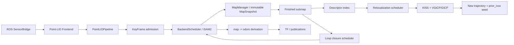

# AdaGraph-LIO 主实现方案与进度基线

状态：当前唯一交接文档；实现与验证以代码和本文件为准

日期：2026-08-15

分支：`feature/point-lio-frontend`

本文固定当前系统的产品决策、运行时方案、代码状态、剩余工作和验收顺序。发生上下文切换时，先读本文，再读
[`ADAGRAPH_LIO_SUBMAP_RECOVERY_LOOP_CLOSURE_PLAN.md`](ADAGRAPH_LIO_SUBMAP_RECOVERY_LOOP_CLOSURE_PLAN.md)
获取具体模块方案和故障处理契约；本文与代码不一致时，以代码和最新测试结果为准，并立即更新本文。

本文件是后续继续开发的唯一入口。其他文档用于解释设计背景，不得用来推翻这里的
产品决策和当前状态。每次完成一项工作，都要同时更新“当前已完成”“当前未完成”和
“验证证据”三处，避免把已经写出的接口误认为已经完成了真实运行验证。

## 1. 产品决策

- `Small Point-LIO` 是唯一实时激光惯导前端。
- `Super-LIO` 已退役，代码和运行时 fallback 不恢复，也不作为兼容路径。
- finished submap 同时承担两种职责：全局重定位目标，以及 Point-LIO 重启后的局部地图 seed。
- 重定位成功后创建新的 `TrajectoryId`，不直接覆盖旧 ESKF 状态继续运行。
- 自动 recovery 和 loop closure 默认关闭，完成数据集和故障注入证据后再开启。
- 历史讨论中的 RSS、CPU、固定内存数字不再是验收门槛；只有明确产品约束后才建立对应 profile 和门限。
- 包名和系统名暂不在本轮改动中扩散重命名。当前代码包为 `hybrid_slam`，产品/论文名暂定 `AdaGraph-LIO`；后续命名变更必须一次性处理 ROS package、节点、launch、配置和文档。

## 2. 目标运行时架构



实时路径只有 Point-LIO：传感器进入前端，前端输出当前轨迹的 odometry 和有限的下游帧。子图构建、descriptor 检索、点云配准、回环和图优化都通过快照或后台队列交接，不能阻塞 Point-LIO 实时更新线程。

## 3. 三种地图不是同一个对象

具体实现按“Point-LIO 实时前端、持久化 submap、后端图优化、后台重定位/回环”分层；
模块职责和禁止跨层行为见
[`ADAGRAPH_LIO_SUBMAP_RECOVERY_LOOP_CLOSURE_PLAN.md`](ADAGRAPH_LIO_SUBMAP_RECOVERY_LOOP_CLOSURE_PLAN.md)。

```text
online_ivox       当前 trajectory 的实时局部地图，可清空、可丢弃
prior_ivox        重定位后加载的 matched submap，只读
persistent submap 后端长期保存的地图产品，用于检索、配准、回环和 seed
```

Point-LIO 的局部 iVox 与 AdaGraph-LIO 的持久化子图不是同一份运行时对象，但表达的是同一环境几何的不同生命周期。恢复时只 materialize 匹配的子图到新 odom 坐标系，不把整个全局地图塞进 Point-LIO。

坐标约定：

```text
M     persistent map frame
O_j   第 j 条 Point-LIO odom frame
S_i   第 i 个 finished submap frame
B     robot base frame
```

重定位结果给出 `T_M_B`，前端当前状态给出 `T_Oj_B`，则：

```text
T_M_Oj  = T_M_B * inverse(T_Oj_B)
T_Oj_Si = inverse(T_M_Oj) * T_M_Si
point_Oj = T_Oj_Si * point_Si
```

`BuildRecoverySeedInOdom()` 是这段转换的唯一实现位置。`map -> odom` 是系统边界派生量，不成为 Point-LIO 的第二套隐藏状态。

## 4. 失跟恢复的完整流程

```text
TRACKING
  -> SUSPECT       健康指标连续变差
  -> LOST          确认失跟，停止地图写入
  -> RELOCALIZING  descriptor top-K + 几何验证
  -> RESTARTING    停止 ingress，创建新 trajectory，reset Point-LIO
  -> VERIFYING     prior_ivox 只读，online_ivox 暂存
      | 失败       清理 provisional online layer，回到 RELOCALIZING
      | 稳定       提交新 keyframe 和 reconnect constraint
  -> RECOVERED
```

### 4.1 候选验证

1. 从 finished submap descriptor index 取 top-K。
2. 校验 `session_id`、`trajectory_id`、`submap_id` 和 submap 版本。
3. KISS 只生成粗配准候选。
4. VGICP/GICP 验证几何一致性。
5. 用 fitness、inlier、overlap、observability 和邻近轨迹一致性拒绝假匹配。
6. 只有完整结果绑定到具体 submap 后，才允许进入 recovery transaction。

descriptor 分数只能用于 shortlist，不能直接改变位姿、发布 `map -> odom` 或加载 seed。

### 4.2 Recovery transaction

调用方负责先暂停 `SensorBridge` ingress。协调器应当完成以下原子语义：

1. 校验 request、snapshot、finished submap 和 seed。
2. 准备新的 trajectory identity 和 `T_M_Oj`。
3. reset Point-LIO 的 ESKF、IMU/LiDAR 队列、时间状态及局部地图。
4. 加载只读 `prior_ivox`，新点进入独立 `online_ivox`。
5. 提交新 trajectory、更新 `map -> odom`，进入 `VERIFYING`。
6. 任一步失败，都必须保持旧 trajectory、旧 map 和旧 alignment 一致，不能留下半提交状态。

当前事务已改为两阶段：`prepareRecoveredTrajectory()` 不改变 active
trajectory，前端 `resetAndSeed()` 成功后才调用
`commitPreparedRecoveredTrajectory()`。剩余风险是真实运行中的 provisional
online layer、重试和 ingress 时序还没有录制数据证据。

## 5. 回环与后端重连

回环和 recovery 共用 submap 检索与几何验证，但图约束职责不同：

```text
recovery reconnect：把新 trajectory 接回已有 map
loop closure：发现同一场景的历史重复经过，约束图的全局漂移
```

标准路径：

```text
finished submap
  -> 选取最多 N 个均匀分布的代表 keyframe
  -> 一个异步 loop batch
  -> 每个 query 排除时间邻近节点并检索 descriptor top-K submaps
  -> KISS 粗配准
  -> VGICP/GICP 验证
  -> 每个 batch 最多发布一条 kLoopClosure / reconnect constraint
  -> BackendScheduler 单写图
  -> iSAM2 返回全部受影响 pose
  -> MapManager 发布新 snapshot
  -> 从当前 trajectory 优化 pose 派生 map -> odom
```

约束：detector 和 verifier 不直接改图；PCL 配准在后台线程；backend callback 只做轻量 handoff；没有新增节点的 loop update 也必须传播所有受影响节点。第一阶段只验证同 session、同 trajectory 回环，跨 trajectory 依赖 reconnect 完整验证。

## 6. 当前已完成

### 子图与定位

- finished submap 局部几何、seed cloud、descriptor、bounds、`T_map_submap`。
- descriptor top-K 检索和 `S_i -> O_j` seed 坐标转换。
- `PclSubmapRelocalizer`：KISS 粗配准、VGICP/GICP 精配准、fitness/inlier/overlap/observability 门控。
- `PclSubmapRelocalizationScheduler`：后台线程、latest-only、旧任务取消。

### Point-LIO 生命周期

- Point-LIO 是唯一实时前端。
- frontend health hysteresis、SUSPECT/LOST 地图写保护。
- recovery `VERIFYING` 窗口独立于 normal health 开关；验证期间允许 provisional
  online layer，禁止 durable keyframe，失败会清理 online layer 并回到 LOST 重试。
- health observation 已包含实例级 timestamp continuity 检查，配置从
  ROS/YAML typed config 传入。
- `prior_ivox` 只读，`online_ivox` 独立可清理。
- `resetAndSeed()`、新 `TrajectoryId` 和应用层 ingress 暂停/恢复路径。
- recovery coordinator 已改为 prepare/commit 两阶段事务；前端 reset/seed
  失败不会提前提交 pipeline 的 trajectory 或 `map -> odom`。
- recovery 成功后 ROS SensorBridge 和 Point-LIO ingress 会重新打开，进入
  `VERIFYING` 窗口；应用层使用查询携带的真实 `T_odom_base`。
- `LOST -> RELOCALIZING` 只提交一次 latest query；候选失败会显式回到 LOST，避免
  每帧重复调度；验证/cooldown 通过后才允许新的 durable keyframe。
- recovery query 在 `LOST` 中累计固定数量的 fresh LiDAR frame（默认 4）；各帧先保留
  在 IMU 传播的 odom 坐标，达到窗口后统一转换到最新 `base` frame。窗口 ready 后冻结，
  cooldown 不会继续无界累积点云。
- backend 的 `map -> odom` 更新不再依赖 `PriorMapLocalization` 作为唯一来源。

### 后端与回环

- iSAM2 在无新增节点的 loop update 中返回完整优化节点。
- BackendScheduler/MapManager 已有跨 trajectory reconnect 的全量 snapshot
  回写测试；ISAM2 也覆盖跨 trajectory、无新增节点的全量结果传播。
- `LoopDetectionSnapshot`、`PclSubmapLoopDetector`、`PclLoopClosureVerifier`。
- `LoopClosureScheduler` 已接入 `point_lio_node`，使用后台线程和 latest-only handoff。
- scheduler 单测覆盖后台执行、任务替换、取消、非法 snapshot 丢弃和 `kLoopClosure` 生成。
- loop closure 已拆成可替换插件边界：`scan_context` 插件只做 polar max-height
  descriptor、ring-key shortlist 和 yaw 检索；`bevplace2` 插件把 BEV 图像发送到
  本机 GPU sidecar 并接收 BEVPlace++ 全局 descriptor。PCL/VGICP verifier 只负责
  几何验真，二者都不能直接改图。KISS 仅保留给 prior-map 初始化和恢复。
- 每个 finished submap 只提交最后一个 keyframe 作为 query。验证源是该触发帧，
  目标是候选锚点及相邻 finished submap 的局部邻域；图初值与 Scan Context yaw
  初值分别尝试。loop 配置可选择粗到细 VGICP：粗层扩大 graph-pose capture
  domain，细层仍以原有 fitness、inlier、overlap 和 observability 门限决定。
- BEVPlace2 sidecar 的稳态单 descriptor 往返中位数为 `18.77 ms`（RTX 3060）；它只在
  completed submap 的后台 loop job 中调用，不共享 Point-LIO callback 线程。Oxford
  的两条端到端 A/B 已验证 `1` 条 VGICP 约束/路线且前端稳定，但两次图修正均只有约
  `5-6 mm`，APE 尚未改善，不能作为精度提升结论。

### 已有验证

```bash
cmake --build build/hybrid_slam -j2
ctest --test-dir build/hybrid_slam --output-on-failure
```

当前回归结果：20/20 tests passed。

真实数据正常路径：

```bash
./scripts/run_m2dgr_eval.sh room_01 1.0 /tmp/adagraph-lio-room-full-20260814
```

最新证据：完整消费 `room_01_ros2.db3`，6940 条 odom，101 个 backend
keyframe，1 个 finished submap，backend 101/101 处理成功，optimizer failures
为 0，snapshot observer failures 为 0，APE RMSE 约 0.396087 m。它只证明
正常路径可运行，不证明 recovery、loop closure 或实机稳定性。

## 7. 当前真实执行检查点（2026-08-14）

这一节是当前进度的事实基线，优先级高于“接口已存在”或旧的阶段性描述。

### 已经被代码和测试证明的部分

- `test_point_lio_recovery_transition` 已覆盖健康状态机、无新输出帧时的 watchdog
  超时、post-LOST recovery-query handoff、固定多帧窗口到最新 base frame 的坐标转换，以及
  验证失败后的回退；当前目标测试为 9/9 通过。
- `point_lio_node` 和 recovery 测试目标可以成功编译、链接和安装。
- 正常 `room_01_ros2.db3` 回放可以完整跑通；它证明正常 tracking/backend 路径，
  不证明自动失跟恢复。
- 双圈故障回放已经真正触发并完成恢复：

  ```text
  TRACKING -> SUSPECT -> LOST
  KISS/VGICP candidate accepted
  Point-LIO submap recovery committed
  VERIFYING -> RECOVERED
  first durable keyframe -> reconnect constraint
  ```

  `/tmp/adagraph-lio-room-recovery-r37-clean-one-second-fault-20260815` 中，
  第一遍/第二遍 bag 切换产生的 LiDAR 空窗和第二遍主动 LiDAR dropout 都完成了
  recovery。摘要为 `verification_committed=2`、relocalization constraints
  `2/2/0`、旧/新 trajectory 均存在，`odom -> base` 发布 7400 条、
  `map -> odom` 发布 3667 条，两个 TF 时间序列均单调。故障 relay 报告
  `dropped_lidar=10`、`normalized_loops=1`。

- `r34` 的长 dropout 仍被严格几何门限正确拒绝；这证明拒绝路径没有被为制造
  recovery 而放宽。`r37` 则证明短时 LiDAR 中断在已有 finished submap 时可以完成
  KISS/VGICP 验证、Point-LIO reset/seed、trajectory rollover 和后端重连。

### 当前尚未被真实数据证明的部分

- 错误 submap、相似场景假匹配、几何退化、坏地图写入、IMU 异常和时间戳异常的
  真实故障矩阵还没有完整跑完。
- recovery verification 失败后的 provisional `online_ivox` 清理、重试和地图不污染
  还缺少完整录制数据证据；单元测试已覆盖基础事务语义。
- prior-map 预加载模式的单次初始定位已完成回放；用预加载地图处理失跟并与在线
  matched-submap seed 做对比的故障回放仍未完成。
- loop closure 已在 Oxford Spires `2024-03-13-observatory-quarter-01` 的 1x
  MCAP 全程回放中以 batch 方式发布 1 条最终回环约束；scheduler 为
  `7 submitted / 7 completed / 1 published`。backend APE RMSE 为 `0.116169 m`，
  关闭回环基线为 `0.116090 m`，因此当前证明的是链路和门限有效，不能宣称精度提升。
  仍缺少更多路线、误回环拒绝率和资源预算证据。
- 2026-08-16 的 UrbanV2X `small_loop` 1x 回放再次验证了独立 Scan Context
  路径：`28 submitted / 28 completed / 1 published`，所有候选均在后台完成。
  最终接受的是 `query_node=2799 -> match_node=800`，采用 graph 初值和粗到细
  VGICP，细层证据为 `fitness=1.02238`、`inlier_ratio=0.823923`、
  `overlap=0.282311`、`observable=true`。该候选的相邻子图目标覆盖了 GT 中约
  200 秒前的同一路段；按 `3098 - 2800 = 298` 个初始化前 LiDAR 帧反推，两个
  图锚点 GT 相距约 `6.25 m`，与邻域子图回环的约束语义一致。此前看似更接近的
  `2699 -> 700` 在两种初值下都未通过几何验证，未写入图。
- 这次只有一条回环，backend APE RMSE 从无约束运行的约 `4.553` 降至约 `4.546 m`；
  该微小差异不能作为精度提升结论。该回放仅证明候选、几何验真、约束提交和优化链路
  在真实数据中闭合，同时保留错误候选拒绝。
- 评测同时记录 `/lio/odom` 和 `/lio/backend/optimized_path`。前者不会被后端
  图优化改写，不能用来判断 loop closure 的轨迹修正。
- 尚未基于上述证据决定是否把自动 recovery 从显式开关改为默认开启。

相关原始输出目录：

```text
/tmp/adagraph-lio-room-two-pass-recovery-final-20260814
/tmp/adagraph-lio-room-two-pass-recovery-seeded-20260814
/tmp/adagraph-lio-room-two-pass-recovery-1x-20260814
/tmp/adagraph-lio-room-two-pass-recovery-window4-r2-20260814
```

### 下一轮工作

1. 补齐失败候选、退化几何、坏地图和 IMU/timestamp fault injection，并确认回滚不污染
   durable map。
2. 单独回放 prior-map 预加载路径的失跟恢复，并与在线 matched-submap seed 对比。
3. 在 Oxford 之外再开启同 trajectory loop closure 做真实路线评估，增加错误候选、
   相似场景和大漂移拒绝用例，再决定是否支持跨 trajectory loop。
4. 根据上述结果更新默认 recovery/loop 策略；继续保留可诊断的显式运行时覆盖。

上述故障矩阵和回环证据完成前，自动 recovery 继续保持显式关闭；不恢复 Super-LIO，也不把历史 RSS、
CPU、内存或频率数字重新设为验收门槛。

## 8. 当前未完成与执行顺序

下面的事项是当前真正需要继续做的工作。历史记录中出现过的固定 RSS、CPU、内存或
频率数字不属于本项目当前验收条件，除非明确提出对应的产品约束。

### P0：完成 recovery 失败矩阵与回滚证据

- `prepareRecoveredTrajectory()` 负责校验和可失败分配，`commitPreparedRecoveredTrajectory()`
  只在前端 reset/seed 成功后提交。
- 已覆盖未知 submap、前端未初始化导致 reset 失败和 IMU 健康故障的测试。
- 失败路径已证明 alignment 不发布、空 map snapshot version 不改变。
- 已增加 pipeline 级 frame 测试：进入 LOST 后不再产生 durable keyframe，
  recovery query 仍通过后台 handoff 出口。

完成证据：`test_point_lio_recovery_transition`、`test_frontend_health`、
`test_frontend_lifecycle` 和 r37 真实回放均通过；r37 已证明
`recovery committed -> VERIFYING -> RECOVERED`、首个 durable keyframe、
跨 trajectory reconnect、MapSnapshot 和 TF 连续性。未完成的是失败候选、
provisional layer 回滚和重试的真实故障矩阵。

### P1：保持 backend reconnect 回归覆盖

- 已构造旧 trajectory + 新 trajectory 的图，并加入跨 trajectory constraint/covariance。
- 已验证 loop/reconnect 后所有受影响节点进入 `MapSnapshot`，不只更新新增节点。
- `map -> odom` 派生路径已存在，r37 已在真实 recovery 数据上验证当前 trajectory
  的优化 pose、TF 和图重连一致。

完成证据：确定性 BackendScheduler、ISAM2 和 r37 人工断开/恢复回放均通过。

### P1：完成剩余恢复故障注入和数据集验证

- LiDAR 短时 dropout、IMU 保持输入已在 r37 验证；还需覆盖更长 dropout 和
  无候选/候选失败路径。
- 几何退化、错误 submap、相似场景假匹配。
- 时间戳异常、IMU 异常、坏地图写入。
- 验证 provisional online layer 失败回滚，不污染 durable map。
- 对比无恢复、空局部地图恢复、matched-submap seed 恢复三条路径。

执行时必须先构造“已经生成 finished submap，再在第二段行程中注入失跟”的场景。
只在第一段还没有 finished submap 时测试 dropout，只能证明“没有候选时会回到
`LOST`”，不能证明子图重定位和 Point-LIO 重启成功。时间戳跳变曾出现过节点崩溃，
需要单独保留日志并先定位生命周期或边界问题，再把它归类为恢复算法问题。

记录成功率、误恢复率、恢复耗时、恢复后的 ATE/RPE、轨迹连续性和地图污染；这些是测量项，不预先编造固定数值门槛。

真实 bag 验证入口已经支持以下显式覆盖，默认仍关闭：

```bash
FRONTEND_HEALTH_ENABLE=true \
SUBMAP_RECOVERY_ENABLE=true \
LOOP_CLOSURE_ENABLE=false \
./scripts/run_m2dgr_eval.sh room_01 1.0 /tmp/adagraph-lio-recovery-eval
```

该入口只打开运行时能力，不代表 bag 已经包含人工失跟；人工断开、dropout 和
错误地图注入仍需单独构造并记录结果。

### P2：完成回环产品化

- 完整 ROS 应用中的 scheduler、finish 和正常退出已通过双遍回放；异常退出仍由单测覆盖。
- 回环调度已改为 finished-submap 级 batch：每个 batch 检查最多 5 个均匀分布的
  query keyframe，但最多发布一条约束。Oxford Spires `observatory-quarter-01`
  的真实重访回放中，scheduler `7/7/1`（submitted/completed/published），有效
  约束为 `query_node=600 -> match_node=0`，KISS 初始内点 `572`，后端最大修正
  约 `5.0 mm`。相同路线的 backend APE RMSE 为 `0.116169 m`，关闭回环基线为
  `0.116090 m`，当前只能证明回环链路和严格门限工作，不能宣称精度已经提升。
  该 batch 的资源代价约为 `180% CPU / 917184 KiB RSS`，仍需优化 KISS 批处理。
  评测使用 MCAP。直接从 8.2 GiB SQLite 大库冷启动短片段曾出现输入读取抖动并
  诱发前端发散，因此不再把该 SQLite 回放作为稳定证据。
- 仍保持默认关闭，直到更多路线、误回环拒绝和资源预算证据稳定。

### P2：继续结构清理

- 把 `PointLIOPipeline` 头文件内部的私有 basic/PCL 算法桥继续移到 adapter；只有严格编译隔离确有收益时才引入 PImpl。
- 将 core 对 basic 中 PCL/glog 类型别名的依赖下沉到 adapter/logging 层。
- 收敛 `FrontendConfig` 与 Small Point-LIO `Parameters` 的重复语义，固定 `ROS/YAML -> typed config -> frontend/backend/localization instance`。
- 清理 legacy 全局配置、旧状态类型和兼容参数面，确保多实例和 session reset 不互相覆盖。

完成证据：core 目标不再需要 ROS/PCL/glog 头文件；配置语义有唯一 owner；边界检查脚本和干净构建通过。

结构清理的具体拆分如下：

| 顺序 | 工作 | 完成判据 |
| --- | --- | --- |
| 1 | 将 core 对 `basic` 中 PCL/glog 类型别名的依赖下沉到 adapter/logging | core 公共头和实现不再包含 ROS/PCL/glog；adapter 编译仍通过 |
| 2 | 清理 `PointLIOPipeline` 头文件里的私有 basic/PCL 算法桥 | 公开接口只保留 typed domain 数据；只有编译隔离确有收益时才引入 PImpl |
| 3 | 收敛 `FrontendConfig` 与 Small Point-LIO `Parameters` 的重复语义 | 参数只从 `ROS/YAML -> typed config -> instance` 进入，vendor 参数仅作边界转换 |
| 4 | 清理 frontend/math 对 `g_*` 全局参数和 legacy 状态的读取 | 多实例配置互不覆盖；session reset 不依赖进程级残留状态 |

这组工作属于架构清理，不是当前 Point-LIO、子图重定位或回环功能的前置阻塞。
应在恢复真实验证链路稳定后分小步执行，每步都配套边界检查和干净构建。

### 暂不做

- 没有明确产品内存约束前，不继续针对大地图 KeyFrame/Submap 长期保留做 profile 或重构。
- 不为了未经要求的 MB 数字改动 Point-LIO 已验证的精度、恢复和实时行为。
- 不重新引入 Super-LIO 作为比较实现或 fallback。
- 不在 recovery 证据完成前默认开启自动 recovery。

## 9. 验收清单

### 功能

- 错误 descriptor 候选不能直接触发恢复。
- 错误几何候选必须被拒绝。
- seed 坐标转换满足 `S_i -> O_j`。
- recovery 创建新 trajectory 且保留旧 graph/map。
- recovery 失败不污染旧图和 prior layer。
- reconnect/loop update 能传播所有受影响 pose。

### 并发与边界

- 配准和检索不阻塞 Point-LIO 实时线程。
- backend 单写线程不执行昂贵 PCL 工作。
- scheduler 停止可收敛，`finish()` 幂等。
- ROS/PCL/glog/vendor 类型不穿透 core 公共接口。
- 配置实例化后不再读取 process-wide `g_*` 全局参数。

### 上线前证据

- 完整单测和干净构建。
- 正常 ROS2 bag 回归。
- 人工失跟并成功恢复。
- 错误候选和退化场景拒绝。
- recovery 后轨迹、地图和 TF 连续。
- recovery/loop 开关的默认值、日志和失败原因可诊断。

## 10. 继续工作时的固定起点

每次继续本项目时按此顺序检查：

1. `git status --short --branch`，保留用户已有改动。
2. 阅读本文第 6、7 节，确认当前 P0/P1 状态。
3. 先处理一个最高优先级未完成项，并补对应测试。
4. 运行 build + ctest；涉及真实数据时记录命令和输出目录。
5. 完成后更新本文的日期、状态和证据，不把“接口存在”写成“功能已验证”。

推荐的恢复上下文提示词：

```text
请先阅读 /home/sw/AdaGraph-LIO/doc/architecture/ADAGRAPH_LIO_MASTER_IMPLEMENTATION_PLAN.md
和其中链接的交接文档，再检查 git status、当前分支和最近测试输出。严格按照“当前未完成
与执行顺序”继续，只做最高优先级的一项；不要恢复 Super-LIO，不要把历史 RSS/CPU/MB
数字当作验收门槛。完成后修改主文档中的状态和验证证据，并运行与改动匹配的测试。
```

## 11. 相关文档

- [`ADAGRAPH_LIO_SUBMAP_RECOVERY_LOOP_CLOSURE_PLAN.md`](ADAGRAPH_LIO_SUBMAP_RECOVERY_LOOP_CLOSURE_PLAN.md)：设计取舍和论文思想映射。
- [`POINT_LIO_SUBMAP_RECOVERY_DESIGN.md`](POINT_LIO_SUBMAP_RECOVERY_DESIGN.md)：坐标、状态机和接口设计原文。
- [`POINT_LIO_SUBMAP_RECOVERY_HANDOFF.md`](POINT_LIO_SUBMAP_RECOVERY_HANDOFF.md)：短版上下文交接记录。
- [`CURRENT_ARCHITECTURE.md`](CURRENT_ARCHITECTURE.md)：当前运行时架构概览。
