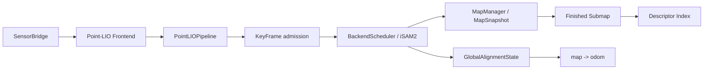

# AdaGraph-LIO 子图重定位、Point-LIO 恢复与回环方案

状态：实现方案、进度基线与上下文交接文档

日期：2026-08-14

分支：`feature/point-lio-frontend`

本文是详细设计文档。项目的唯一进度入口是
[`ADAGRAPH_LIO_MASTER_IMPLEMENTATION_PLAN.md`](ADAGRAPH_LIO_MASTER_IMPLEMENTATION_PLAN.md)，
上下文恢复时先读主计划，再读本文和
[`POINT_LIO_SUBMAP_RECOVERY_HANDOFF.md`](POINT_LIO_SUBMAP_RECOVERY_HANDOFF.md)。
设计原理和代码进度分开记录，避免把“已经有接口”误认为“已经完成实机验证”。

## 1. 最终目标

系统只保留 Point-LIO 作为实时激光惯导前端，同时让同一个持久化子图具备两种用途：

1. 作为全局重定位的候选目标，回答“当前扫描在历史地图的什么位置”。
2. 作为 Point-LIO 重启后的局部地图种子，帮助新轨迹快速恢复局部匹配。

回环检测复用同一套子图检索和几何验证能力，但它是后续能力，不能替代失跟恢复。
Super-LIO 不恢复、不作为 fallback，也不作为新系统的依赖。

核心原则：

```text
健康时：Point-LIO 负责实时 odom -> base
失跟时：历史子图负责 map 中的定位，新 Trajectory 负责恢复 Point-LIO
回环时：历史子图提供候选，后端图优化负责改变全局一致性
```

## 2. 为什么采用组合方案

没有一篇论文完整解决本项目的全部问题，因此采用按职责组合的工程方案：

| 问题 | 采用的思想 | 在本项目中的落点 |
| --- | --- | --- |
| 长期地图组织 | Cartographer/GLIM 的 submap 思路 | `MapManager` 和不可变 `MapSnapshot` |
| 前端失跟后的生命周期 | Voxel-SLAM 的新轨迹/重连思路 | 新建 `TrajectoryId`，保留旧图 |
| 历史几何帮助 LIO 恢复 | Super-LIO 的 prior-map reuse 思想 | 只加载匹配子图为只读 `prior_ivox`，不引入其代码 |
| 错误匹配不污染地图 | CT-ICP 的保守地图写入思想 | LOST/VERIFYING 期间禁止或暂存写入 |
| 几何配准实现 | 项目已有 KISS + VGICP/GICP | 全部放在 PCL adapter |
| 实时前端 | Point-LIO | 唯一实时 ESKF/LIO 前端 |

这不是声称某一篇论文已经验证了完整链路，而是把不同论文中经过验证的机制放在
清晰的模块边界内组合起来。

## 3. 系统中的三类地图

Point-LIO 的局部 iVox 和 AdaGraph-LIO 的持久化子图不是同一个对象，但二者共享
同一批环境几何的不同生命周期表示。

```text
Point-LIO online_ivox       当前轨迹实时匹配，短期、可丢弃
Point-LIO prior_ivox        已验证历史子图，恢复期间只读
AdaGraph persistent submap 长期保存，用于检索、配准、回环和 seed
```

正常运行时，Point-LIO 只维护当前局部地图；后端 `MapManager` 按 keyframe 组织持久化
地图并生成 finished submap。恢复时，持久化子图被转换到新 odom 坐标系，作为
`prior_ivox` 的初始内容；新扫描产生的点进入独立的 `online_ivox`。

因此：

- 不是把整个全局地图塞进 Point-LIO。
- 不是让 Point-LIO 直接拥有全局图优化状态。
- 不是用 descriptor 分数直接改变位姿。
- 不是用 `setPose()` 覆盖旧 ESKF 后继续跑旧局部地图。

## 4. 坐标系和所有权

```text
M       持久化全局 map 坐标系
O_j     第 j 条 Point-LIO 局部 odom 坐标系
S_i     第 i 个 finished submap 的局部坐标系
B       机器人 base 坐标系
```

所有权固定如下：

| 状态 | 所有者 |
| --- | --- |
| `O_j -> B`、ESKF、IMU 队列、局部 iVox | Point-LIO frontend |
| keyframe、submap、图约束、优化后的 `M -> B` | Backend/`MapManager` |
| 当前 `M -> O_j` | 系统边界的派生 `GlobalAlignmentState` |
| PCL 点云、KISS、VGICP/GICP | adapter 层 |

注册结果若给出当前 base 在地图中的位姿，则新轨迹的全局对齐为：

```text
T_M_Oj = T_M_B * inverse(T_Oj_B)
```

把子图 `S_i` 变成新 odom 局部种子：

```text
T_Oj_Si = inverse(T_M_Oj) * T_M_Si
point_Oj = T_Oj_Si * point_Si
```

`BuildRecoverySeedInOdom()` 是这段转换的唯一实现位置。图优化更新后，重新从优化后的
keyframe 和当前 Point-LIO 位姿推导 `M -> O_j`，不能把它偷偷变成 Point-LIO 的第二个状态。

## 5. 正常运行数据流



实时线程只处理传感器和 Point-LIO。子图生成、快照、检索、配准和图优化之间通过
不可变快照或后台队列交接，不能让后端单写线程执行昂贵的 PCL 配准。

## 6. 子图数据结构

finished submap 至少保存以下内容：

```cpp
struct SubmapSnapshot {
  SubmapId id;
  SessionId session_id;
  TrajectoryId trajectory_id;
  SubmapState state;
  StampedTransform3d T_map_submap;
  ImmutablePointCloud cloud_submap;
  ImmutablePointCloud seed_cloud_submap;
  std::vector<float> descriptor;
  BoundingBox3d bounds;
  std::vector<KeyFrameId> keyframe_ids;
  double quality_score;
  std::uint64_t version;
};
```

各表示的职责不同：

- descriptor：快速候选检索，不能单独证明位姿正确。
- coarse cloud：KISS 或粗配准。
- fine cloud：VGICP/GICP 几何验证。
- seed cloud：新轨迹的 Point-LIO 局部地图初始化。
- keyframe payload：图优化、保存、诊断。

第一阶段仍以 keyframe 作为图节点，submap 是地图和定位组织单元。暂不急于把每个
submap 改造成独立图节点。

## 7. 重定位和恢复事务

恢复必须有明确的状态机和提交点：

```text
TRACKING
  -> SUSPECT       连续健康证据变差
  -> LOST          确认失跟，停止地图写入
  -> RELOCALIZING  top-K 子图检索和几何验证
  -> RESTARTING    创建 O_j，重置 Point-LIO，加载 seed
  -> VERIFYING     prior 只读，online 暂存
      | 失败 -> 丢弃 online，回到 RELOCALIZING
      | 稳定 -> RECOVERED
  -> COMMITTED     提交新 keyframe 和图重连约束
```

### 7.1 进入 LOST

健康监测使用已有的有效点数、inlier、残差/可观测性、IMU 连续性和短窗口运动一致性，
采用滞回而不是单帧阈值。进入 LOST 后：

- 不再接受坏帧为全局 keyframe。
- 不再向旧轨迹的在线局部地图写入新点。
- 保存旧轨迹和历史地图，不清空 `MapManager`。
- 把最新有效查询交给 latest-only recovery scheduler。

### 7.2 候选验证

```text
descriptor top-K
  -> materialize 候选 submap
  -> KISS 粗配准
  -> VGICP/GICP 精配准
  -> fitness + inlier + overlap + observability 门控
  -> 轨迹/邻近 keyframe 一致性检查
  -> 返回带 submap_id 的结果
```

候选结果必须绑定 `session_id`、`trajectory_id`、`submap_id` 和质量证据。错误候选必须在
创建新轨迹、加载 seed 之前被拒绝。

### 7.3 新轨迹和 seed

确认重定位成功后，由应用层暂停 `SensorBridge` ingress，随后原子完成：

1. 分配新的非零 `TrajectoryId`，保留当前 session、后端和持久化地图。
2. 重置 Point-LIO ESKF、IMU/LiDAR 队列、deskew 时间状态和局部地图。
3. 用 `S_i -> O_j` 变换 materialize 匹配子图。
4. 将 seed 写入只读 `prior_ivox`，新点只进入 `online_ivox`。
5. 恢复 ingress，进入 VERIFYING。

重定位用的那一帧只作为新轨迹初始化，不再作为普通 LiDAR 更新重复消费，避免一帧数据
同时承担两次状态更新。

### 7.4 验证和提交

验证窗口内：

- `prior_ivox` 不能被修改。
- `online_ivox` 可以独立清空。
- 新 keyframe 进入有界 provisional buffer。
- 失败时丢弃 provisional 数据，不污染旧图和 seed。
- 连续健康后，按时间顺序提交 keyframe，并加入 recovery reconnect constraint。

## 8. 回环闭环

回环是恢复基础设施的第二个消费者：

```text
finished submap
  -> 取最后一个 keyframe 作为 query
  -> 一个异步 loop job
  -> 可替换 descriptor plugin top-K（排除时间邻近子图）
  -> 候选锚点和相邻 finished submap 形成局部目标
  -> graph pose / descriptor 粗初值分别交给 VGICP 验真
  -> 每个 job 最多构造一条 kLoopClosure constraint
  -> BackendScheduler 单写入图
  -> iSAM2 输出全部受影响节点
  -> MapManager 更新快照和 map->odom
```

实现约束：

- detector 只做候选筛选，verifier 只做测量验证，二者都不能改图。`scan_context`
  是独立实现，不复制或 vendoring 上游实现；`bevplace2` 是本机 Unix socket GPU
  sidecar，使用上游 BEVPlace++ checkpoint 生成 8192 维全局 descriptor。Python/CUDA
  不进入 Point-LIO callback；KISS 不参与回环。
- scheduler 在后台线程运行，使用 latest-only；新快照到来时替换尚未开始的 pending，
  但不取消已经开始的 job。完成一个 submap 才触发一次，因此不会形成 keyframe-rate
  配准队列。
- backend snapshot callback 只做 O(1) handoff，不能在单写线程里执行点云 materialize 或配准。
- 回环约束没有新节点，因此优化器必须返回全部受影响的优化位姿，不能只返回新增节点。
- 第一阶段先启用同 session/同 trajectory 回环；跨 trajectory 等 recovery reconnect 完整验证后再开。
- 回环默认关闭，直到单测、数据集和故障注入证据齐全。

2026-08-16 UrbanV2X `small_loop` 1x 证据：Scan Context 完成 `28/28` 个 job，
发布 1 条约束。`2699 -> 700` 是第一检索候选，但 graph 和 Scan Context 两种初值都未通过
VGICP 几何验真；它被正确拒绝。末段 `2799 -> 800` 使用 graph 初值通过粗到细 VGICP，
细层 `fitness=1.02238`、inlier ratio `0.823923`、overlap `0.282311`，发布到后端图。
该结果证明链路可闭合和拒绝门限仍然生效，不证明单一回环已带来总体精度提升。

2026-08-16 BEVPlace++ 替换检索层的证据：离线、因果检索（至少相隔 30 s，GT 距离
10 m 内为真回访）在 Oxford Spires `keble-college-02` 的 Top-1/Top-5 为
`84.44%/84.44%`，`observatory-quarter-01` 为 `99.12%/100%`。端到端运行中，
Observatory 为 `8 submitted / 8 completed / 1 published`，Keble 为
`7 submitted / 7 completed / 1 published`；两次均保持与关闭回环基线相同量级的
keyframe 数，未复现 Scan Context 在 Keble 上的前端失稳。两条约束的最大图优化平移
仅约 `5.2 mm` 与 `5.8 mm`，所以 APE 没有改善：Observatory backend RMSE
`0.114756 -> 0.116387 m`，Keble `0.166311 -> 0.170262 m`。该结果证明候选质量、
隔离边界和严格几何门有效，不证明整体轨迹精度已提升。

运行 `bevplace2` 前必须先启动 `scripts/run_bevplace2_sidecar.sh`；默认使用机械盘中的
`/run/media/sw/仓库/BEVPlace2` 上游 MIT checkout 与其附带 checkpoint。sidecar 不可用时
插件只丢弃 descriptor 请求并返回空候选，节点与前端仍可正常运行。

## 9. 当前代码进度

截至 2026-08-14，当前分支的代码状态如下：

### 已完成或已有基础

- finished submap 的局部几何、seed cloud、descriptor、bounds 和 `T_map_submap`。
- descriptor top-K 检索和 `S_i -> O_j` seed 转换。
- frontend health、地图写入保护、`prior_ivox/online_ivox` 双层地图。
- `VERIFYING` 生命周期不会因为 normal health monitor 关闭而被跳过；验证期间只允许
  provisional online layer 写入，global keyframe admission 仍被阻止。
- Point-LIO `resetAndSeed()` 和新 trajectory 生命周期。
- `PclSubmapRelocalizer`：KISS 粗配准、VGICP/GICP 验证及质量门控。
- `PclSubmapRelocalizationScheduler`：latest-only 后台恢复调度。
- LOST 到 recovery query 的 Pipeline 接线；应用层在验证成功后暂停 ingress，再 reset/seed。
- 验证失败时清理 provisional online layer，并将状态显式退回 `LOST`；候选失败后允许
  下一条较新 query 重新进入 `RELOCALIZING`，不会每帧重复提交同一恢复任务。
- iSAM2 对没有新增节点的图更新返回完整优化结果。
- backend `map->odom` 更新已不再强依赖 `PriorMapLocalization`。
- `LoopDetectionSnapshot`、`PclSubmapLoopDetector`、`PclLoopClosureVerifier` 和
  `LoopClosureScheduler` 基础接口。

### 9.1 模块职责固定表

后续实现按下面的职责边界进行，不能因为某个功能暂时方便就跨层持有状态：

| 模块 | 负责 | 不负责 |
| --- | --- | --- |
| `SensorBridge` | ROS 消息、时间戳、传感器 ingress 开关 | 不修改图、不执行全局配准 |
| `PointLIOFrontend` | ESKF、IMU/LiDAR 队列、`odom -> base`、实时局部 iVox | 不拥有全局 map、不做回环 |
| `PointLIOPipeline` | frontend frame 到 keyframe/health/recovery handoff 的适配 | 不在实时回调中做 PCL 重配准 |
| `MapManager` | keyframe、submap、轨迹、约束和不可变 snapshot | 不直接读取 ROS 参数 |
| `PclSubmapRelocalizer` | descriptor 候选后的 KISS + VGICP/GICP 几何验证 | 不创建 trajectory、不写 backend |
| `PointLIORecoveryCoordinator` | prepare/reset/seed/commit 事务 | 不绕过验证直接发布恢复结果 |
| `BackendScheduler` + iSAM2 | 图约束单写入、优化、全量受影响节点传播 | 不执行昂贵点云配准 |
| `LoopClosureScheduler` | 后台候选调度和约束 handoff | 不直接修改 `MapManager` |
| ROS/YAML adapter | 参数解析、ROS/PCL/vendor 类型转换 | 不把全局 `g_*` 配置带进 core |

已有回归通过：

```text
test_frontend_lifecycle
test_frontend_result
test_frontend_health
test_point_lio_recovery_transition
test_pcl_submap_relocalizer
test_core_domain
test_isam2_optimizer
test_loop_closure_scheduler
PclSubmapLoopDetector same-trajectory/cross-trajectory tests
```

已完成一次真实 ROS2 bag 正常路径验证：

```bash
./scripts/run_m2dgr_eval.sh room_01 1.0 /tmp/adagraph-lio-room-full-20260814
```

该次运行完整消费 `room_01_ros2.db3`，产生 6940 条 odom、101 个 backend
keyframe 和 1 个 finished submap；backend 101/101 处理成功，optimizer failures
为 0，snapshot observer failures 为 0，APE RMSE 约 0.396087 m。这个结果只证明
正常路径可以运行，不是自动 recovery 或 loop closure 的精度验收，也不构成任何固定
RSS/CPU 门槛。

注意：`Datasets/room_01_ros2/room_01.txt` 是 TUM 真值轨迹，不能直接作为
`hybrid_slam_dataset_runner` 的 typed packet 输入；对应的 ROS2 传感器输入是
`room_01_ros2.db3`，由 `run_m2dgr_eval.sh` 播放。

### 当前未完成

1. 定向 recovery/health 回归已重新编译并运行通过（recovery transition 8/8，health 8/8）；
   完整 CTest 已有 20/20 通过基线。恢复后的 durable keyframe 现在明确在
   verification/cooldown 通过后才提交。
2. 短时 LiDAR dropout 的真实 recovery、durable keyframe、跨 trajectory reconnect、
   `map -> odom` 和 TF 连续性已由 r37 回放验证；错误 submap、相似场景假匹配、
   几何退化、IMU 异常和时间戳异常仍需单独验证。
3. recovery verification 失败时，provisional `online_ivox` 的清理、重试和再次进入
   `RELOCALIZING` 已有代码和单测，但仍需失败录制数据验证。
4. prior-map 预加载路径还没有与在线子图 seed 路径完成对比回放。
5. Oxford Spires `observatory-quarter-01` 的 1x MCAP batch 对照中，scheduler 为
   `7 submitted / 7 completed / 1 published`，有效回环最大优化平移改动约 `5.0 mm`。
   backend APE RMSE 为 `0.116169 m`，关闭回环基线为 `0.116090 m`，暂不能宣称
   精度提升；batch 资源约 `180% CPU / 917184 KiB RSS`，仍需优化。前端
   `/lio/odom` 不包含后端修正，必须评估 `/lio/backend/optimized_path`。
6. PCL/basic 算法桥仍有部分留在 `PointLIOPipeline` 私有头文件；只有要求严格编译依赖隔离时，
   再用 PImpl 继续隐藏。
7. core 对 basic 中 PCL/glog 类型别名的依赖、`FrontendConfig` 与 Small Point-LIO
   `Parameters` 重复语义仍需继续下沉和收敛。

## 10. 具体实施顺序

每一步都必须留下代码、测试或真实数据证据，再进入下一步：

1. **恢复事务回归**：确认 reset 失败不提交新 trajectory；确认恢复后的验证窗口和冷却
   通过后才产生第一个 durable keyframe，并带一个 `kRelocalization` constraint。
2. **故障注入**：构造 LiDAR 短时 dropout、IMU/timestamp fault、错误 submap 和几何退化，
   检查状态机是否按 `SUSPECT -> LOST -> RELOCALIZING -> VERIFYING` 运行。
3. **恢复回滚**：在 verification 失败和候选耗尽时，确认旧 durable map 不变、prior layer
   不变、provisional online layer 被清理，重试不会重复消费同一帧。
4. **真实 reconnect**：在一段真实录制中制造失跟并恢复，验证新 `TrajectoryId`、跨轨迹图约束、
   iSAM2 全量结果、`MapSnapshot`、`map -> odom` 和 TF 的连续性。
5. **三路对比**：比较正常运行、恢复但不加载 seed、恢复并加载 matched-submap seed；记录
   恢复成功率、误恢复率、恢复耗时、ATE/RPE、轨迹跳变和地图污染。
6. **回环评估**：先只打开同 session/同 trajectory 回环，确认约束数量、错误候选拒绝和
   ATE/RPE 变化；再决定是否支持跨 trajectory loop。
7. **结构清理**：将 core 对 basic/PCL/glog/vendor 的类型依赖继续下沉到 adapter；统一
   `ROS/YAML -> typed config -> instance`，消除 legacy 全局配置和重复参数语义。
8. **默认策略**：在上述证据齐全前，`SUBMAP_RECOVERY_ENABLE=false`、
   `LOOP_CLOSURE_ENABLE=false` 保持不变。Super-LIO 不恢复、不作为 fallback。

## 11. 故障处理契约

| 故障 | 必须发生 | 禁止发生 |
| --- | --- | --- |
| frontend health 连续恶化 | 进入 `SUSPECT/LOST`，停止 durable map 写入 | 把坏帧继续写入旧轨迹 |
| descriptor 候选错误 | 在几何验证阶段拒绝 | 仅凭 descriptor 分数 reset Point-LIO |
| `resetAndSeed()` 失败 | abort prepare，旧 trajectory/alignment/map 保持不变 | 先发布新 `map -> odom` 再回滚 |
| verification 失败 | 清理 provisional online layer，保留只读 prior，允许重试 | 污染 finished submap 或旧图 |
| reconnect/loop 优化 | 回写全部受影响节点到 snapshot | 只回写新增节点 |
| 时间戳/IMU 不连续 | 进入 health fault，禁止恢复前写图 | 用不连续数据伪装正常 tracking |

## 12. 验证命令与当前结果

```bash
cmake --build build/hybrid_slam -j2 --target test_point_lio_recovery_transition
build/hybrid_slam/test_point_lio_recovery_transition

cmake --build build/hybrid_slam -j2
ctest --test-dir build/hybrid_slam --output-on-failure

bash -n scripts/run_m2dgr_eval.sh
python3 scripts/verify_core_boundaries.py
```

截至 2026-08-14，本轮已确认：recovery transition 测试 8/8 通过，health 测试
8/8 通过；完整回归已有 20/20 通过基线，`bash -n scripts/run_m2dgr_eval.sh` 和 core boundary verifier
也通过。上述结果验证的是当前实现基础，不等于真实失跟恢复或回环已经完成。

正常数据回归：

```bash
./scripts/run_m2dgr_eval.sh room_01 1.0 /tmp/adagraph-lio-room-full-20260814-p1
```

打开能力开关不等于完成验证。当前 bag 没有人工失跟，不得把“bag 播放完成”写成
“recovery 成功”：

```bash
FRONTEND_HEALTH_ENABLE=true \
SUBMAP_RECOVERY_ENABLE=true \
LOOP_CLOSURE_ENABLE=false \
./scripts/run_m2dgr_eval.sh room_01 1.0 /tmp/adagraph-lio-recovery-eval
```

## 13. 暂不做的事情

- 没有明确产品约束前，不以固定 RSS、CPU、延迟或 MB 数字作为退役/上线门槛。
- 不为了未经要求的内存数字破坏 Point-LIO 已验证的精度、恢复和实时行为。
- 不恢复 Super-LIO，不保留 Super-LIO fallback，不用它作为验收前提。
- 不在 recovery 和 loop closure 的真实证据完成前默认开启自动策略。

## 14. 验收清单

### 功能正确性

- descriptor 错误候选不能直接触发恢复。
- 几何上错误的 submap 会被拒绝。
- seed 坐标变换满足 `S_i -> O_j` 约定。
- recovery 创建新 trajectory，但不删除历史 keyframe/submap/graph。
- 失败恢复不会污染旧地图或只读 prior layer。
- 回环约束能让所有受影响节点更新并进入下一版 snapshot。

### 运行安全

- 配准和检索不阻塞 Point-LIO 实时线程。
- backend 单写线程不执行昂贵 PCL 工作。
- scheduler 停止时线程可收敛，`finish()` 可重复调用。
- recovery 和 loop 默认关闭，参数来源是 ROS/YAML -> typed config -> instance。
- ROS/PCL/glog 类型不穿透 core 公共接口。

### 评估证据

至少使用录制数据和故障注入覆盖：几何退化、错误地图写入、LiDAR 短时丢失但 IMU 正常、
IMU/时间戳异常。记录成功/误恢复、恢复耗时、轨迹连续性、ATE/RPE、地图污染和回滚结果。
这些是验证项，不是预先编造的硬门槛。

## 15. 参考资料

- [Point-LIO](https://doi.org/10.1002/aisy.202200459)：实时激光惯导前端和局部地图生命周期。
- [Cartographer](https://github.com/cartographer-project/cartographer)：submap 与 multi-trajectory 组织。
- [GLIM](https://arxiv.org/abs/2407.10344)：局部子图表示和地图产品化思路。
- [Voxel-SLAM](https://arxiv.org/abs/2410.08935)：失跟处理、新轨迹和跨轨迹重连思路。
- [CT-ICP](https://arxiv.org/abs/2109.12979)：保守地图写入和地图污染控制。
- Super-LIO：仅吸收 prior geometry reuse 的思想，不保留其代码或运行时 fallback。
